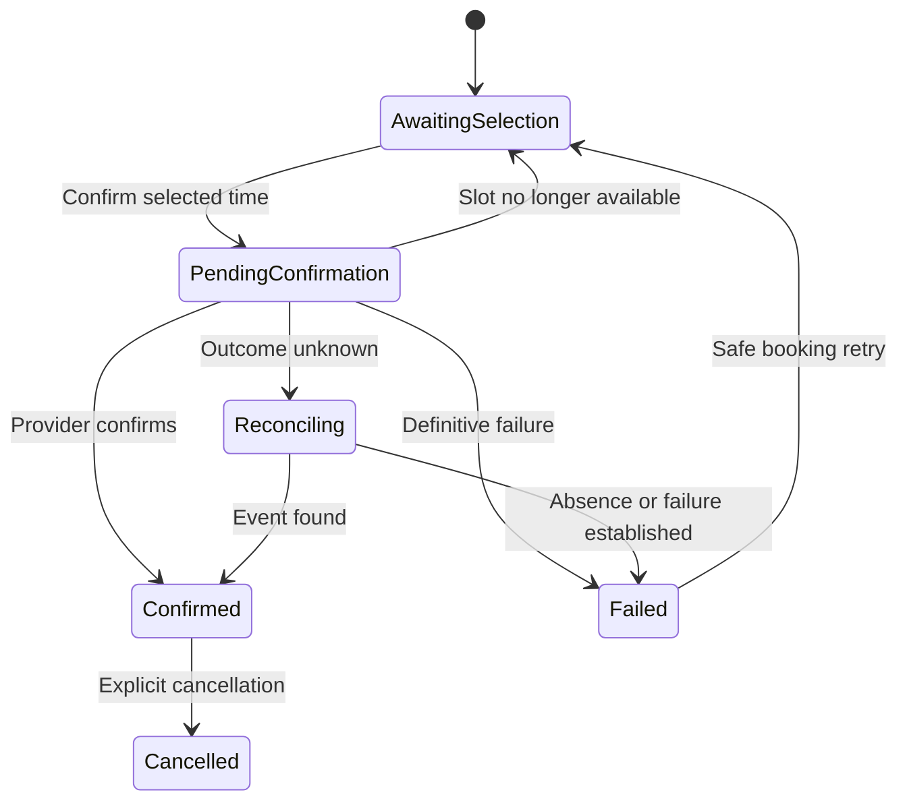

# Claritia Routing — detailed workflow and implementation guide for Claude

**Revision:** 2 · 31 October 2026  
**Purpose:** Build the Routing experience demonstrated in the approved interactive prototype, with production behavior defined explicitly.  
**Status:** Product specification. The repository, database, deployed behavior, and calendar integrations have not been inspected while writing this guide.

## Read this first

Claude: implement this as a coherent extension of the existing Claritia application. Inspect its code before choosing table names, endpoints, components, or integrations. Reuse existing authentication, CRM records, forms, scheduling, tasks, design components, and audit infrastructure wherever possible.

The interactive demo is the visual and interaction reference: restrained Claritia styling; a left navigation; **Policies / Teams / Activity**; a compact policy editor; a separate lead tester; source connections; and **Route & book**. This document is the behavior contract. If the prototype's shortcuts conflict with this document, follow this document and explain the difference in the implementation notes.

Do not copy the demo's in-memory objects, sample people, fake availability, browser-side allocation, or simplified booking confirmation into production. Sample scenarios in this guide are test fixtures, never real workspace data.

### Instructions to give Claude

> Read this entire guide before changing Routing. Inspect the existing repository and applicable AGENTS.md instructions. Map current forms, owners, teams, scheduling, publishing, and CRM writes to the contracts below. Preserve the approved interaction design. Implement in the ordered stages in Section 25, with a working vertical slice before expanding functionality. Use the shared server-side evaluator for both simulation and real assignment. Finish the required acceptance scenarios and report what was verified, any incomplete integration, and any deliberate deviation. Do not mark an operation as successful when only its UI exists. Do not invent credentials, working calendar integrations, production data, or migration results. Keep deployment and external actions within the user's existing authorization.

## Contents

1. Product promise and scope
2. Vocabulary and ownership boundaries
3. Navigation and screen map
4. State and persistence rules
5. Policies list and first-time setup
6. Create-policy workflow
7. Policy editor: actions and interactions
8. Source connections and field mapping
9. Submission checks and CRM matching
10. Existing-owner behavior
11. Conditions and ordered rules
12. Teams, eligibility, and distribution
13. Public form: full runtime journey
14. Internal handoff: full runtime journey
15. Booking and calendar recovery
16. Lead tester and test evidence
17. Publish, versions, conflicts, and restoration
18. Activity, review, and manual recovery
19. Notifications and follow-up tasks
20. Roles and permissions
21. Data model and operation contracts
22. Concurrency, retries, and idempotency
23. UI copy, loading, errors, and accessibility
24. Migration from the existing Claritia interface
25. Implementation stages and completion gates
26. Acceptance scenarios and deterministic fixtures
27. Definition of done and implementation handover

## 1. Product promise and scope

Routing answers three questions: **Who should own this lead? Why that person? What happens if nobody can receive it?** Scheduling subsequently answers: **Can the prospect or a teammate book a meeting with that owner?**

The initial production contract is **owner first**:

1. Accept a valid submission or a confirmed internal handoff action.
2. Capture the relevant source, policy version, and CRM facts.
3. Apply submission checks and existing ownership, then ordered assignment rules.
4. Commit one owner or a monitored review outcome.
5. If the source requests booking, show the assigned owner's calendar.
6. Create a meeting only after a specific time is selected and confirmed.

Leaving the calendar does not undo an assignment. A disconnected calendar does not erase a lead. A calendar failure does not trigger a second allocation.

### Required scope

- Named reusable routing policies with drafts and published versions.
- A simple “Send everything to me” setup and a conditional-routing setup.
- Connected Claritia forms and internal contact handoffs.
- Typed rule conditions, explicit grouping, ordered evaluation, and a default destination.
- Reusable teams, individual eligibility, assignment caps, and equal round robin.
- Existing contact/company ownership with visible precedence and permitted recipient scope.
- Side-effect-free simulation, source-specific visitor previews, and publish validation.
- Assignment, review, booking, follow-up, and recovery history.
- Durable persistence, server authorization, idempotency, and concurrency protection.

### Deliberate later extensions

Weighted distribution, pooled earliest-available booking, arbitrary workflow/API sources, paid enrichment, SLA automation, bulk reassignment, complex nested conditions, and AI editing are extensions. Do not hide a required base workflow behind one of these features.

Pooled earliest-available booking is a separate **booking-first** mode: the pool's slots appear before a final owner is chosen. It needs provisional allocation and different fairness semantics. Do not quietly introduce it into owner-first Routing under a label such as “next available.”

## 2. Vocabulary and ownership boundaries

| Term | Definition |
| --- | --- |
| Policy | Named reusable assignment configuration, such as Inbound sales |
| Draft | Saved unpublished configuration; affects tests only |
| Published version | Immutable policy snapshot used by new real invocations |
| Source | A form or authorized internal entry point invoking Routing |
| Source connection | The shared configuration linking a source to a policy, mappings, and a completion/booking outcome |
| Recipient scope | Explicit people/teams whose members this policy may assign to |
| Destination | A specific person, team, or manual-review queue |
| Eligible recipient | A permitted person who passes the applicable assignment checks |
| Assignment | The committed contact-owner decision |
| Suggestion | A previewed recipient that is not yet committed |
| Routing run | A durable real decision attempt, with inputs, version, trace, and outcome |
| Simulation | An evaluator execution that does not change business state |
| Booking | A separate calendar operation linked to the routing run and committed owner |
| Review item | A monitored work item requiring an authorized human decision |
| Retention | Keeping exactly the same already-recorded contact owner |

### One source of truth for each responsibility

| Area | Owns |
| --- | --- |
| Routing policies | Submission-handling preferences, scope, owner precedence, ordered assignment rules, default, fallback, and review responsibility |
| Routing teams | Ordered reusable member pools and distribution method |
| Member settings | Accepting/paused status, PTO, assignment cap, time zone, connected calendars, and working hours |
| Form/source connection | Policy selection, field mappings, assign-only versus show-calendar, meeting type, and visitor completion settings |
| Meeting type | Duration, location, buffers, notice, booking window, reminders, and rescheduling rules |
| Routing run | Historical decision, original facts, reasons, and assignment outcome |
| Booking record | Calendar state, provider references, host, event time, and reconciliation state |

For routed bookings, **host = committed contact owner**. A fixed host on a meeting type must not silently compete with Routing. Use an explicit routed host mode or adapt existing meeting configuration so only one host selector applies.

Standalone meeting links may explicitly target their own person/team. They do not secretly replace the owner in a routed form journey.

Assigning a contact does not automatically change its company's owner, opportunity owner, or an existing booked meeting's host. Those are separate records and deliberate actions.

## 3. Navigation and screen map

Keep the approved visual style: light neutral navigation and surfaces, clear text, black primary actions, restrained green success states, compact fields, and little decorative chrome. Follow the application's existing responsive and dark-mode conventions.

### Top-level Routing tabs

| Tab | Primary content | Main action |
| --- | --- | --- |
| Policies | Named policies, status, connected sources, and access to the editor | Create policy |
| Teams | Reusable recipient pools and member readiness | Create team / manage members |
| Activity | Real routing runs, review items, and recoverable errors | Inspect a run or review item |

### Screens and entry points

| Screen | Entry | Back destination |
| --- | --- | --- |
| Policies list | Routing → Policies | App navigation |
| Create policy | Create policy | Policies |
| Policy editor | Open a policy | Policies |
| Connected sources | Editor → Manage sources, or Forms → After submission | Preserve the originating screen |
| Rule editor | Rule → Edit | Close inline editor; stay on policy |
| Test a lead | Policy → Test lead | Same policy and draft position |
| Review & publish | Policy → Publish changes | Policy editor |
| Teams | Routing → Teams | Preserve selected team when returning |
| Route & book | Contact action or policy shortcut | Originating contact/policy |
| Activity list | Routing → Activity | App navigation |
| Run/review detail | Activity row | Previous filters and list position |
| Version history | Policy overflow → Versions | Same policy |

Use the existing application router and navigation patterns. Do not require these exact URL paths if they conflict with the repository.

## 4. State and persistence rules

### Policy state

| State | Meaning | UI |
| --- | --- | --- |
| New draft | No published version exists | Draft |
| Published, unchanged | Draft content equals the published configuration | Published vN |
| Published with edits | Live version remains active; draft differs | Published vN · draft changes |
| Published, disconnected | Valid published configuration has no enabled real source | Published · not connected |
| Archived | New invocations are disabled after sources are repaired/disconnected | Archived |

“Connected” counts in the editor refer to the draft and must be labeled as draft changes when they differ from live connections. A Policies list may show published source count plus a pending-change indicator. Never show a draft attachment as already live.

### Separate runtime dimensions

| Dimension | Canonical example values |
| --- | --- |
| Assignment | pending, held_for_review, assigned, unassigned_needs_review, excluded, failed |
| Booking | not_requested, awaiting_selection, pending_confirmation, confirmed, unavailable, abandoned, cancelled, failed |
| External sync | not_required, pending, complete, failed |
| Review item | open, approved_pending_execution, in_progress, resolved, dismissed |

Avoid one status field that must somehow mean both “assigned” and “booked.” A lead can be assigned while its booking is unavailable or its external CRM sync is pending.

A run with no new recipient does not necessarily mean the contact has no historical owner. Holding a submission or failing to allocate must not clear an existing contact owner. Show “No new assignment; needs review” when that distinction matters, and preserve the pre-run owner in the trace.

### Persistence expectations

- Draft edits autosave to a durable draft record. Show Saving → Saved or Couldn't save.
- Reloading restores the last successfully saved draft.
- Published versions are immutable.
- Only server-confirmed writes update a real success state.
- Tests and recipient suggestions do not modify contacts, owners, counters, tasks, events, or outbound-message queues.
- Persisting a test report and its configuration fingerprint is allowed; it is distinct from a real routing run and business state.
- Team operational changes affect future assignment immediately after their own successful save; policy-rule edits require publication.
- A draft has a revision. Conflicting edits from another tab/user must be detected instead of silently overwritten.

## 5. Policies list and first-time setup

### Initial empty state

Title: **Decide who receives each lead.**  
Description: **Create a policy, connect a form, and test the path before publishing.**  
Primary action: **Set up routing**.

Offer two starting points: **Send everything to me** and **Route by conditions**. Do not require a team for a solo account.

### List columns

Policy name, published/draft status, live source count, destination summary, most recent real run, and Open. Show No runs rather than invented usage metrics.

### Policy actions

| Action | Behavior |
| --- | --- |
| Open | Load saved draft and published metadata; retain live version |
| Rename | Edit draft name; commit the name with publication |
| Duplicate | Create a disconnected draft with copied rules and references; revalidate access and dependencies |
| Archive | Review affected sources; require a safe replacement or disconnection plan before archival |
| Restore archived | Restore as a disconnected draft unless explicit source reconnection is reviewed |
| View versions | Show author, time, version, change summary, and restore action |

Duplicating does not duplicate teams, people, calendars, contacts, meetings, tasks, or source bindings. Its name defaults to “Original name — copy.”

## 6. Create-policy workflow

### Step A — Basics and starting point

Inputs: policy name, starting template, and permitted recipient scope. Proposed name validation: trimmed, nonempty, maximum 80 characters; explain this limit inline. Duplicate names may be allowed with clear IDs/context, or follow the existing application rule.

“Send everything to me” creates no conditional rules, sets the current member as the default destination, and restricts scope to that member. It must not retain an unrelated existing owner outside that scope.

“Route by conditions” starts with an editable rule structure, not real assignments or sample customer data. Example rules may be offered as templates but require the user's own team references.

On Create draft: validate input → save draft → open editor. On failure: remain in the form, retain inputs, show a specific error. Double-clicking must not create two policies.

### Step B — Connect sources

Allow existing forms and internal handoff. Unpublished policies may have draft source connections, but real invocations continue to use each source's current live connection until publication.

The form and Routing surfaces edit one shared source-connection configuration. No second hidden copy may exist under Forms.

### Step C — Complete the editor

The user configures checks, ownership, scope, rules/default, unavailable-recipient fallback, and review responsibility. These are sections on one understandable editor, not separate prerequisite products.

### Step D — Test and publish

The user runs a test of the saved draft, inspects the outcome, and publishes a concrete change summary. An unconnected but published policy is permitted but must remain labeled not connected.

## 7. Policy editor: actions and interactions

The editor follows the approved demo's order:

1. Where leads come from.
2. Checks and existing ownership.
3. Ordered assignment rules and Everyone else.
4. If nobody can receive the lead.

Header: breadcrumb, editable policy name, live/draft status, **Test lead**, and **Publish changes**. Expose **Route & book** when a published handoff-enabled version exists. Put version history and duplicate/archive in an overflow menu.

### Source section

Show readable connected-source chips and Manage. When source changes are unpublished, show Pending change, not a live success badge. Display each resolved meeting type by name; never “the form's own meeting.”

### Checks section

Hold suspected spam is an explicit setting with a review destination. Explain that it prevents automatic assignment and booking until reviewed. A work-email-only restriction belongs to the form and is not equivalent to spam detection.

Existing ownership has an enabled/disabled state, company/contact precedence, and a visible recipient-scope summary. If individual preservation toggles are supported, still show the effective complete order.

### Rule rows

Each row shows priority, name, condition summary, destination, and distribution summary. Example: **US enterprise · Country is US AND employees ≥ 201 → Enterprise US · round robin**.

| Control | Required interaction |
| --- | --- |
| Add rule | Append an incomplete draft rule, expand its editor, focus its name, and mark draft unsaved/saving |
| Edit | Expand an inline editor without losing other draft values |
| Done | Collapse when valid, or keep open with field-level errors; it does not publish |
| Move up/down | Reorder draft rules; update priorities and summaries; preserve focus |
| Delete | Remove from draft; offer Undo until the next deliberate edit/navigation boundary; never delete a published snapshot |
| Add condition | Add a typed incomplete condition; incomplete values block publishing |
| Remove condition | Keep the draft editable; zero conditions is an explicit validation error |
| Match all/any | Update the logical grouping and generated summary immediately |
| Destination | Choose a permitted person/team or review; reference a reusable entity |

Up/down controls are required even if drag-and-drop is later added. Reordering must be keyboard accessible. Do not reset the team distribution queue when moving or renaming rules.

The **Everyone else** destination is always visible below the rules. It is not another reorderable conditional rule and cannot be silently deleted.

### Unavailable-recipient fallback

This applies after a destination is chosen but cannot provide an eligible recipient. Keep it distinct from Everyone else. The former means “a rule/default chose this destination, but allocation failed”; the latter means “no rule matched.”

Required choices: one named backup person/team or manual review. Every exhausted fallback ends in a monitored review queue. The default implementation uses a policy-wide backup; per-rule backups may be added only if their precedence is explicit.

The initial implementation permits one backup hop, then review. Self-reference and cyclic fallback references are blocked. Do not add recursive fallback chains silently.

### Existing routing assistant

If the application already has an assistant input for changing Routing, preserve it through the same draft-patch service rather than introducing a second writer. The assistant proposes structured changes, shows the affected conditions/destinations/sources, validates references, and asks for missing business values when necessary. Accepting its suggestion edits the draft; it does not publish or make real assignments. Apply the same permission, revision, testing, and publication checks as manual editing. Adding a new AI feature is not required for the base release.

## 8. Source connections and field mapping

### Connection fields

| Field | Meaning | Validation |
| --- | --- | --- |
| Source | Existing Claritia form or internal handoff entry point | Same workspace and accessible |
| Policy | One primary routing policy | Published before live activation |
| Connected/enabled | Whether new real requests use this connection | Draft changes are staged |
| Field mappings | Source field ID to canonical routing field/type | Type-compatible and unambiguous |
| Outcome | Assign only or assign and show calendar | Required |
| Meeting type | Explicit named meeting definition | Required for calendar outcome |
| Completion | Thank-you message or explicit permitted redirect | Required safe completion |
| No-slots behavior | Visitor message plus follow-up handling | Required for calendar outcome |

An individual form has at most one primary live routing policy. Connecting it to a different policy shows the previous connection and affected behavior before applying the change. Do not silently execute both policies.

### Assign only

Save the valid submission, resolve/update the contact, run assignment, then show its configured completion. No event or booking session is created. The route can still end in review; the visitor receives a generic safe completion rather than an internal staffing error.

### Assign and show calendar

Run the same assignment. If an owner is committed and availability can safely be retrieved, show that owner's times for the selected meeting type. If the lead is held, unassigned, or no slots can be retrieved, show the configured fallback message. Internal reasons stay in Activity.

### Field mapping

Use stable field IDs, not visible labels, as references. Show a readable preview:

| Form field | Canonical value | Type |
| --- | --- | --- |
| Work email | Contact email | Email |
| Company size | Employee count | Integer |
| Country | Company country | Country identifier |

If Company size is a range selector, map it to a range/enum field, not an exact count. Never convert 51–200 into a made-up value such as 125. Support explicit range comparisons if the existing field registry allows them; otherwise rules must use the selected range as an enum.

Country storage should use the existing canonical country identifiers; labels are presentation only. Normalize compatible display labels at ingestion through one shared adapter.

Show unmapped required rule fields and their impact before publication. A rule field available on one connected form but not another needs either a valid missing-data path or a corrected mapping. Do not assume every form has identical questions.

### Editing, disconnecting, and concurrent source changes

Connections are edited from both Forms and Routing through the same canonical draft and publication service. Use revision checks to detect another editor changing the same source. A policy release may atomically include its staged connection changes; see Section 17.

Disconnecting Routing must leave the form with a safe explicit outcome: capture submissions into the workspace review queue, or connect a replacement published policy. Disable the routed-calendar step if no owner can be resolved. Do not leave a dangling policy reference or a form that loses valid submissions.

If an older form page submits fields incompatible with a newly published connection, preserve the valid submission and send it to review with schema/mapping mismatch. Request a page refresh for genuinely invalid input; do not discard an accepted submission because routing configuration changed.

## 9. Submission checks and CRM matching

### Order

1. Validate form/request structure and required input at the source.
2. Persist an accepted submission/request envelope with a unique source-request key.
3. Resolve the live policy and connection revision and capture inputs.
4. Normalize fields and identify an existing contact/company.
5. Apply the configured hold/review checks.
6. Proceed to ownership and assignment only when permitted.

If an existing database model requires a minimal contact at capture time, reuse that architecture; keep it unassigned when held. Otherwise a held item may remain only a submission until approval. In both designs, it must be durable, discoverable, and linked when a contact is created. Do not create duplicate contacts merely to satisfy this guide's terminology.

### Contact matching

Use the application's documented exact normalized email rule. Trim surrounding whitespace and use its established case handling consistently. Do not perform fuzzy identity matching as an invisible default. Distinct accepted submissions from the same person remain distinct submission records.

### Company matching

Prefer a trusted existing contact-company relationship or explicit authorized company ID. Domain inference is optional and must exclude public/shared email providers. Multiple plausible account matches go to review with an explanation; never pick the first database row arbitrarily.

### Data provenance and precedence

Store both the value used and its origin. Default decision precedence:

- Current explicit form answers supply this submission's routing attributes.
- CRM records supply existing ownership and trusted relationships.
- Existing enrichment may fill missing attributes only when configured.

Using a form value for this routing decision does not automatically authorize overwriting an authoritative company field. Keep those writes under the CRM's existing update rules.

Paid enrichment is not a prerequisite. If an existing integration is used, apply a bounded timeout and continue via missing-data handling or review. Record timeout/failure separately from “field genuinely unknown.”

### Held requests

Create one review item with a named responsible person/team. Do not consume a round-robin turn, quota, follow-up sales task, or meeting. Use a generic visitor completion. Approval later creates an explicit child attempt, not an invisible mutation of the original history.

## 10. Existing-owner behavior

The default sequence is company owner → contact owner → assignment rules. Administrators may choose contact first or disable preservation. Effective precedence must always be readable in the editor and trace.

### Eligibility and effects

| Case | Result | New quota | Team queue |
| --- | --- | --- | --- |
| Eligible current contact owner is selected | Retain owner | No | No advance |
| Previously unowned contact receives its company owner | New assignment | Yes | No advance |
| Contact changes from its old owner to company owner | New assignment | Yes for new owner | No advance |
| Existing owner is outside permitted scope | Skip with reason | None yet | None yet |
| Existing owner is paused/PTO/inactive | Skip with reason | None yet | None yet |
| Current contact owner is at the daily cap | Retain if otherwise eligible | No new charge | No advance |
| Company owner would be a new owner but is at cap | Skip; evaluate next ownership candidate | None yet | None yet |

Scope is evaluated against the policy's explicit people and current memberships of its permitted teams. A person being a workspace member is not sufficient.

For an SDR-to-AE handoff, the initiating SDR is not a recipient merely because they currently own the contact. If they are outside the permitted AE pool, skip them and explain why.

Calendar connectivity and available slots do not determine whether the same person may own a lead. They determine the booking outcome after ownership is resolved.

Resolve the previous owner before writing the new one. A policy must not accidentally read its own newly written owner and then report that as pre-existing CRM ownership.

If no candidate survives, proceed to ordered rules. If both owner types point to the same person, do not evaluate or charge that person twice.

## 11. Conditions and ordered rules

### Required model

A rule has an immutable ID, editable name, enabled state if supported, order, **all/any** grouping, one or more typed conditions, and a destination. IDs remain stable when reordered or renamed.

| Field type | Initial supported comparisons | Missing-data behavior |
| --- | --- | --- |
| Number/integer | Equals, at least, at most | Ordinary comparisons false |
| Country/enum | Is, is not, one of if supported | Ordinary comparisons false |
| Text | Exact equality; further operators only when specified | Ordinary comparisons false |
| Any supported nullable type | Is known, is unknown | Explicitly evaluates presence |

Keep numeric input and comparisons numeric. Reject malformed or impossible values during configuration. Do not compare numbers lexicographically. Employee count is a positive whole number when known. Unknown is null/missing, not zero.

“Is not United States” does not match unknown country. Use “Country is unknown” deliberately. Empty condition arrays are invalid even if a language's every() function would return true.

### Grouping

Match all means every condition is true. Match any means at least one is true. Show AND/OR in the generated summary and explain the group above the inputs. Do not present a mixed series of independent and/or dropdowns that hides precedence.

If the current application already stores nested groups, preserve their semantics through migration. Either support them explicitly or keep them read-only until an equivalent editor exists. Never flatten them during migration.

### Evaluation and trace

Evaluate enabled valid rules in saved order. The first matching rule selects the destination. Mark subsequent rules not evaluated rather than falsely saying they failed. If nothing matches, use Everyone else.

If a matched destination lacks an eligible recipient, invoke the configured unavailable-recipient fallback; do not evaluate a later assignment rule. This keeps territory and segment boundaries explicit.

### Reference example

| Priority | Name | Conditions | Destination |
| --- | --- | --- | --- |
| 1 | US enterprise | Country = US AND employees ≥ 201 | Enterprise US |
| 2 | Other enterprise | Employees ≥ 201 | Enterprise global |
| 3 | Vietnam | Country = Vietnam | Vietnam sales |
| Default | Everyone else | No earlier match | General sales |

Consequences: an 800-person US company uses rule 1; an 800-person Vietnamese company uses rule 2 before rule 3. If the intended business behavior is “all Vietnam leads stay in Vietnam,” move Vietnam above the enterprise rules or add appropriate exclusions. The editor/tester must make this ordering consequence visible rather than guessing intent.

## 12. Teams, eligibility, and distribution

### Team setup

Create team → enter name → select existing members → review order/distribution → save. The initial method is equal round robin. A team is reusable across multiple policies; show the count and names of affected published policies when modifying it.

Required membership controls: add/remove member, inspect assignment readiness, and preserve a stable member order. Reuse the existing member profile for calendar/time-zone/working-hours settings.

### Member status is multidimensional

| Setting | Assignment effect | Booking effect |
| --- | --- | --- |
| Accepting leads | Permits new allocation | None by itself |
| Paused | Blocks new allocation and automatic preservation under this contract | Existing meetings remain |
| Out of office | Excludes during configured PTO interval | No new slots during PTO |
| Calendar disconnected | Assignment still possible | Booking unavailable until reconnected |
| Outside working hours | Ownership assignment still possible | Offer future valid slots |
| Daily assignment cap reached | Blocks a new owner allocation; does not block retaining the same owner | No effect on an already-owned meeting |

PTO dates use a visible time zone. Do not conflate “not working at this moment” with “out of office.”

Status controls are explicit operational changes. On successful save they affect future assignments without policy publication. Show the shared/live effect before destructive membership changes. Cap, membership, and distribution changes have their own saved revision and audit record. A rule draft must not hide live team changes.

Member status and caps are workspace-wide preferences reused by all teams. The UI must make clear that pausing Ana in one team's view pauses her new allocations in her other teams too; it is not an unexplained team-local switch.

### Eligibility order

Check same workspace → permitted policy scope → active member → accepting leads → not in PTO → applicable quota. Then select from the team's ordered eligible pool. Capture a reason for each excluded member.

### Round robin

The fairness unit is a successfully committed new contact-owner allocation. A preview, simulation, page refresh, failed write, repeated request, owner retention, cancellation, and no-show do not consume a turn.

Use one shared queue per team, not one queue per rule or policy. At commit, start from the team's persisted next position, skip ineligible members, pick the first eligible member, then advance to the position after that member. Never reset the queue merely because a policy is edited.

If a rule-selected member already owns the contact, record retention and do not advance/count a new allocation. Existing-owner matches are direct ownership decisions, not a turn in a team's queue.

Adding a member appends a stable membership position. Removing a member repairs an affected pointer without restarting the whole queue. Returning from PTO resumes ordinary rotation; there is no automatic catch-up debt in this version.

### Quotas

Count unique committed new owner allocations across the workspace, including different teams and policies. A transfer to another person charges the recipient; it does not refund the old recipient. A repeated retry with the same operation ID charges nobody twice.

Support an explicit No limit option. A numeric cap is a positive whole number. Display count, cap, time zone, and next reset. Keep a stable quota period; a time-zone change takes effect after the current period ends rather than instantly clearing usage.

Lowering a cap below current usage is allowed with an explanation: future new allocation is blocked until reset; existing ownership is unaffected. Changes to counts are not user-editable production controls.

If every member is excluded, try the configured in-scope backup once, then manual review. A team containing zero members is a configuration problem, not a person to assign to.

## 13. Public form: full runtime journey

### Visitor journey

| Step | Visitor sees/does | System behavior | Durable outcome |
| --- | --- | --- | --- |
| 1 | Opens a published form | Loads supported form schema and safe public settings | No lead assignment |
| 2 | Completes fields | Client validation assists; server remains authoritative | No lead assignment |
| 3 | Selects Submit | Disable repeat submission while the accepted request is processing | One request/submission identity |
| 4 | Sees a brief processing state | Persist accepted data and run checks/assignment | Run pending, held, assigned, or needs review |
| 5a | Assign-only completion | Display the configured thank-you/redirect | Owner saved or review item created |
| 5b | Booking calendar | Read the committed owner's valid slots | Booking awaiting selection |
| 5c | Follow-up completion | No safe slots, held submission, or no owner | Ownership retained if assigned; appropriate review/task |
| 6 | Selects a slot and confirms | Revalidate slot and create the calendar operation | Pending confirmation, then confirmed or recoverable failure |
| 7 | Sees confirmed meeting details | Display provider-confirmed result | Booking linked to committed owner and routing run |

Never show “Meeting booked” immediately after form submission. Do not expose rep capacity, spam scores, CRM matching ambiguity, or internal fallback configuration to a public visitor.

### Processing behavior

The server resolves published configuration at acceptance and stores the resolved policy version and source revision on the run. The public browser never supplies a trusted recipient, team cursor, quota decision, or arbitrary destination.

If processing exceeds a short UI wait, show **“Your details are saved. We're finishing your request.”** Continue using the accepted request identity. Poll/resume through the existing application pattern. A network retry must not create another routing request with an unrelated identity.

Use a scoped resume token/session for public booking continuation. It must not expose general CRM access or allow changing another lead's owner. Keep these tokens under the existing application's security conventions.

### Owner committed, calendar abandoned

The owner remains assigned. Proposed default: mark an unconfirmed booking session abandoned after 30 minutes of inactivity, configurable through existing scheduling/session settings. This means “no confirmation in this session,” not “lead rejected.” A valid later resumption may return it to awaiting selection or confirm it; history preserves both events.

If an abandonment follow-up is configured, create one linked task for the owner. If the meeting is later confirmed, resolve the outstanding scheduling follow-up instead of leaving misleading duplicate work.

### Representative public messages

| Situation | Suggested copy |
| --- | --- |
| Assign-only success | Thanks — we've received your request. |
| Ready to book | Choose a time with Ana. |
| No slots | Thanks — your rep will contact you to arrange a time. |
| Accepted but processing slowly | Your details are saved. We're finishing your request. |
| Chosen slot taken | That time was just taken. Please choose another. |
| Provider outcome unknown | We're confirming your meeting. Please keep this page open. |
| Confirmed | You're booked with Ana. |

Completion wording may be customized by the workspace, but its factual meaning must match the actual state.

## 14. Internal handoff: full runtime journey

### Entry

Primary path: Contacts → open contact → **Route & book**. Policy editor may expose a shortcut that asks for a contact first. Reuse existing contact access rules.

### Handoff form

Show contact name/email/company, current owner, published policy, chosen meeting type, required routing attributes, and relevant missing-field prompts. If only one published eligible policy exists, show it read-only rather than an unnecessary single-option selector.

Prefilled CRM values remain labeled as known data. A local routing override is distinguished from an intentional CRM field update. Do not save edited contact/company attributes merely because the user clicks Find recipient.

### Action contract

| Action | Allowed effects | Forbidden effects |
| --- | --- | --- |
| Open handoff | Read authorized data | Change owner/counters |
| Edit input | Update local handoff state | Silent CRM writes |
| Find recipient | Evaluate published rules; read safe availability | Commit assignment, task, invitation, or queue turn |
| Select a time | Store a local selection | Claim a confirmed event |
| Assign without booking | Recheck, then commit assignment once | Create a meeting |
| Confirm handoff & book | Recheck, commit assignment, then request booking | Pretend the provider confirmed before it did |
| Cancel/back before commit | Discard local suggestion/slot | Undo someone else's committed work |

### Suggested-recipient panel

Show recipient name, matching rule/ownership reason, selected team, exclusion reasons, current-owner retention versus change, and an explicit **“Not assigned yet”** label. Show sample/demo wording only in development fixtures; production slots must come from the real integration.

For new ownership, display **“Owner will change from Vincent to Ana.”** For retention, **“Ana already owns this contact.”** This is important when the initiating person is an SDR and the recipient is an AE.

### Changes between preview and confirmation

At commit, re-read authoritative contact ownership, active published configuration, recipient eligibility, relevant queue position, and selected-slot availability.

The preview references the policy version used to produce it. If that policy's published pointer changed, or authoritative CRM attributes relevant to the decision changed, refresh the suggestion before committing. Keep the recorded version for historical runs; do not silently apply a different live policy inside an old preview.

If the resulting recipient differs, clear the selected slot and show **“Routing changed since your preview. Review the new recipient before confirming.”** Require the user to acknowledge the refreshed suggestion. Do not book the new person's calendar while displaying the old name.

### Assignment then booking

The commit boundary saves ownership before the external event operation. If booking fails, show **“Lead assigned to Ana. Meeting not confirmed.”** Keep the saved assignment and provide a booking-specific recovery action. Do not roll the lead back to the SDR or allocate another rep silently.

After Assign without booking, booking status is not_requested even if availability was previewed. After successful booking, it is confirmed. A suggestion is never rendered as an assignment record.

### Manual overrides

Only authorized roles may override a recipient. Restrict choices to permitted scope and normal eligibility in the first implementation. Require a reason; show the original automatic recommendation and final choice in Activity. There is no implicit cap/PTO bypass. Exceptional override permissions can be a deliberate later extension.

An override is a deliberate assignment decision, not a forged automatic rule match. Explicit direct overrides consume new-recipient quota when ownership changes but do not advance an unrelated team's automatic queue.

## 15. Booking and calendar recovery

### Slot generation

Read the assigned owner's connected calendars through the existing scheduling integration. Apply the meeting type's duration, buffers, minimum notice, booking window, working hours, busy intervals, PTO, and supported time-zone rules.

Render times in a visible visitor-selected/detected time zone. Store the actual instant and relevant zone rather than treating a formatted local time as a universal timestamp. Verify daylight-saving behavior using the existing date/time implementation.

Do not treat a failed calendar read as an empty list of genuinely free times. Internally distinguish no slots, disconnected account, permission error, integration timeout, and unknown availability. Publicly use the configured safe follow-up outcome.

### Confirmation states

PendingConfirmation and Reconciling can share the canonical pending_confirmation state with different internal reasons. Do not build an extra public status vocabulary unnecessarily.

### Slot conflict

Recheck immediately before event creation. If unavailable, retain contact ownership, clear the stale selected slot, refresh valid slots, and ask the visitor to choose again. Do not charge another assignment or create a second routing run for this recovery.

### Unknown event-create outcome

A timed-out response does not establish whether an event was created. Persist the booking intent/correlation reference and reconcile through the provider's supported mechanism before another create attempt. Inspect the current integration and official provider contract; do not assume every provider accepts an idempotency key.

Internal idempotency prevents duplicate app intents. External event creation still requires provider-aware deduplication and reconciliation. Never promise impossible exactly-once delivery across an integration based only on a disabled button.

### Provider confirmed, another step failed

If the event exists but CRM sync or an internal notification fails, keep booking confirmed and mark only that downstream step pending/failed. Retry that step using the existing event reference. Never create a replacement calendar event just to retry CRM sync.

### Existing sessions and meetings

Public runs keep the policy/source snapshot resolved at acceptance. Editing a policy does not reroute their committed owner. A policy change does not move any existing meeting to another host.

If an already-committed owner is subsequently deleted or loses calendar access, stop unsafe booking and show the configured fallback. An administrator can explicitly reassign and initiate a new booking path with audit history. Previously confirmed meetings follow the existing scheduling product's explicit transfer/cancellation process.

Rescheduling changes the linked booking while preserving owner by default. Cancellation/no-show updates booking/attendance history; it does not refund a lead-assignment turn or erase ownership.

## 16. Lead tester and test evidence

### Entry and layout

**Test lead** opens a focused view or drawer. It does not permanently occupy half the rules editor. Preserve draft values, rule expansion, and return location.

Use a compact input area and a readable result trace. Stack on narrow screens. Never duplicate Company size as both a numeric field and an unexplained range field.

### Inputs

Policy draft or published version; connected source; actual mapped source fields; optional authorized existing-contact lookup; explicitly labeled simulation overrides for CRM ownership, suspected spam, recipient unavailability, and booking availability.

The source selector must reflect the selected version's connections. A form disconnected in the draft may still be available when testing the published version. Switching versions resets an invalid source selection and clears stale results.

Test scenario chips, matching the demo: **Enterprise / Returning lead / No slots / Needs review**. They fill visible input values; they do not write to the CRM or silently change real member status. Prefer a booking-enabled source for a No slots scenario.

### Test execution

1. Validate the configuration and entered test data.
2. Save any pending draft edits before choosing its exact revision.
3. Read authorized dependencies and capture the test snapshot.
4. Call the same evaluator used for production decisions.
5. Generate an explanation and source-specific visitor outcome.
6. Save only test evidence/configuration fingerprint if needed.

The production committer and event-creation service are not invoked. Simulation must not advance a queue, consume quota, create/update contacts, create review/follow-up tasks, send communications, or create events. External availability reads, when used, remain read-only; simulated availability is clearly labeled.

### Output contract

| Trace stage | Information |
| --- | --- |
| Input | Relevant values and provenance; missing values distinguished from failures |
| Checks | Passed, held, or rejected, with reason |
| Ownership | Candidates, precedence, eligibility, and skips |
| Rules | Conditions above the match, winner, and later rules not evaluated |
| Distribution | Destination, member exclusions, queue snapshot, and suggested recipient |
| Assignment | Would retain, newly assign, or require review |
| Booking | Would show named calendar, thank-you, or no-slots follow-up |

Required footer: **“Preview only. No contacts, assignments, queue turns, tasks, or meetings changed.”** Do not show that footer on real Activity records.

### Result invalidation

Changing any test input clears the old result immediately or labels it stale. Editing rules, mappings, destinations, ownership settings, or source outcomes invalidates evidence for that draft. Do not keep showing an old recipient beneath new values as though it were a current result.

Team/member configuration changes used by the policy mark relevant evidence stale. Normal live queue advancement, quota usage, or calendar occupancy changes do not make publishing permanently impossible; instead label the result a snapshot and recheck at real execution.

### Evidence and publish gate

Require at least one completed dry run of the exact current configuration before each publication. Store draft fingerprint, dependency configuration revisions, author, time, source, and result summary. A completed expected manual-review outcome counts as an exercised path; malformed configuration or an evaluator failure does not.

If a happy-path destination is temporarily unavailable, show a warning plus the real fallback rather than pretending the test passed to a rep. Publishing may proceed only when configuration is valid, review responsibility is set, the user has reviewed that outcome, and required formal acceptance checks pass.

One test is a minimum workflow gate, not proof of universal correctness. Offer representative cases for owner retention, defaults, missing data, capped members, and unavailable calendars.

## 17. Publish, versions, conflicts, and restoration

### Publication boundary

Use one publishing service from both Forms and Routing. A release plan identifies the policy draft revision, optional staged source-binding revisions, their expected live revisions, dependency configuration revisions, and the test evidence fingerprint.

A live source binding references the stable policy ID. At request acceptance, resolve that policy's active published version plus the binding's active revision together and store both on the run. Publishing a policy changes future invocations of its connected sources. Source-specific outcomes remain canonical source-binding settings.

When a release includes both rule edits and connection edits, publish them atomically or expose a coherent release pointer. Do not allow a form to briefly use new mappings with incompatible old policy rules because two unrelated writes raced.

If publishing from Forms changes only a source connection to an already-published policy, show the exact active policy/version it will use. An unpublished policy draft is not activated implicitly. Publishing both the policy and connection requires the combined reviewed release plan.

### Review screen

Show policy name, version to be created, changed rules/order/default/ownership/fallback, changed source outcomes/mappings, sources affected, test evidence, validation errors, and dependency warnings. Distinguish unaffected existing assignments/appointments from future behavior.

| Blocking errors | Warnings requiring review |
| --- | --- |
| Missing name/default/review responsibility | No connected sources |
| Incomplete or invalid condition | Overlapping rules |
| Unmapped required field without a valid missing-data path | A later rule may be shadowed |
| Deleted/out-of-scope destination reference | Currently no eligible team member |
| Invalid/cyclic fallback | Calendar currently unhealthy |
| Missing meeting type for calendar outcome | Existing owner's eligibility may change at runtime |
| Unsupported active source | Configuration is valid but a test exercises the fallback |
| Stale draft/source revision or stale required evidence | Source count changes |

Only claim a rule is unreachable when the validator can actually establish it. A heuristic overlap warning is not proof.

### Confirm publication

Disable repeated submission while publishing. The server rechecks permissions, revisions, references, validation, evidence, and publication plan. On success create immutable vN+1 and activate the release for new requests. Show **Published vN+1** only after server confirmation.

On failure retain draft and previous live version. If a request times out after possible success, query the publication operation ID before attempting to create a second version.

### Concurrent editing

If another user changes the draft or a shared source binding, show who/what changed when known, preserve the user's local edits, and offer reload/compare/reapply. Do not silently last-write-wins publish. Publishing with a stale base revision is a conflict, not permission to overwrite.

### History and restoration

History includes version, author, timestamp, change summary, and affected sources. Restoring a version copies it into a new draft or reviewed release; it never rewrites historical runs. Source reconnections or mapping changes in a restoration need explicit review, particularly when a source is now attached elsewhere.

Restoration creates a new published version after normal validation/testing. It does not bulk-reassign existing contacts, reverse quota history, rewind team queues, or transfer meetings.

## 18. Activity, review, and manual recovery

### Activity list

Default to real runs, with **All runs / Needs review / Errors** filters and existing application date/pagination patterns. Show lead/submission, source, policy version, matched rule/reason, owner, assignment state, booking state, sync state when relevant, and timestamp.

A dry run belongs in optional test history, not the real-run feed. Show No runs yet in an empty production workspace. Do not seed real workspaces with the prototype's sample activity.

### Run detail

Include run/request identity, actor, source revision, immutable policy version, relevant input snapshot/provenance, previous owner, selected destination, exclusions, assignment result/time, booking reference/state, sync outcomes, and an event timeline. Show a historical committed record separately from any current owner that changed later.

Use **Assigned to Ana** for a committed write and **Suggested recipient: Ana** only for previews. Do not label a merely selected local slot a confirmed meeting.

### Review lifecycle

| State | Meaning | Next actions |
| --- | --- | --- |
| Open | Needs a responsible person to inspect it | Approve, correct data, assign manually, dismiss |
| Approved pending execution | Cleared for an explicit routing attempt | Run/confirm the child attempt |
| In progress | An authorized retry/assignment is processing | Resume/status, not duplicate commit |
| Resolved | A safe terminal result was committed | View outcome and child run |
| Dismissed | Explicit decision not to route | View reason; reopen through authorized action |

Approval alone is not an assignment and must not make unfinished work disappear from the review queue. Needs review includes approved/in-progress items until they are resolved or dismissed, with appropriate labels.

Every item has an assigned reviewer/team, source/run link, reason, creation time, latest action, and responsible actor. If a designated reviewer leaves, preserve the item and escalate to the workspace's configured admin review responsibility.

### Approve and rerun

1. Inspect the original reason and data.
2. Correct permitted data or clear the hold explicitly.
3. Choose whether the child attempt uses the original policy version or a specified current published version. Default to the original version when still valid; show any reason it cannot be reused.
4. Preview the new decision if needed.
5. Confirm a real action with a new child-attempt ID linked to the original.
6. Resolve the parent only when the child commits a safe terminal outcome.

A child's input corrections are new facts with provenance; do not rewrite the original decision trace. An infrastructure retry of the original request is different from an intentional rerun and keeps the original idempotency identity.

### Manual reassignment

Show current owner, proposed owner, eligibility, affected contact, and reason field. Commit through the same safe allocation service. Charge a new recipient allocation once if ownership changes. Do not modify company/opportunity ownership automatically. Existing appointments remain with their hosts unless the user separately invokes a supported transfer/reschedule action.

### Error-specific actions

| Error | Correct recovery | Wrong recovery |
| --- | --- | --- |
| Calendar disconnected | Reconnect; resume booking | Allocate a different rep silently |
| No slots | Follow-up or choose future allowed times | Claim a meeting was booked |
| Event outcome unknown | Reconcile provider intent | Blindly create another event |
| CRM external sync failed | Retry sync of known assignment/event | Re-run full routing |
| Destination unavailable | Explicit backup or review | Try an unrelated segment rule |
| Configuration/schema mismatch | Correct draft/mapping; explicit child attempt | Drop accepted submission |
| Review task awaiting execution | Resume/complete child attempt | Mark resolved at approval |

## 19. Notifications and follow-up tasks

Keep internal activity, internal notifications, task creation, provider invitations, and marketing emails distinct.

| Trigger | Initial behavior | Responsible recipient |
| --- | --- | --- |
| Assignment committed | Activity entry; configured internal assignment notification | New owner |
| Held/unassigned | One review work item and app notification | Named review owner/team |
| Owner has no bookable slots | One linked scheduling follow-up task | Assigned owner |
| Booking session abandoned | Follow-up only if explicitly configured | Assigned owner |
| Booking confirmed | Existing scheduling confirmation/invitation path | Relevant booking participants |
| Calendar/CRM error | Recoverable internal state/notification | Owner/admin with permission |

Task creation uses a deduplication key based on run and purpose. A retried no-slots lookup must not create five identical tasks. If a scheduling task already exists for the same run, update/reuse it. Booking confirmation resolves superseded pending scheduling follow-up.

No review item or task may have no responsible person/team. If assignment is unavailable, responsibility belongs to the review queue rather than a nonexistent rep.

Do not add new email/SMS providers as hidden prerequisites. Reuse existing notification infrastructure. If an external channel is not configured, keep an actionable in-app record and show its true delivery state. Sending through both the calendar provider and Claritia must not produce duplicate invitations.

Nurture enrollment, marketing consent handling, sequences, and campaigns are separate configured product actions. Routing does not silently subscribe every submission to a campaign.

## 20. Roles and permissions

Adapt these capabilities to existing roles rather than creating a parallel permission system.

| Capability | Admin | Scoped manager | Rep | Read-only |
| --- | --- | --- | --- | --- |
| View allowed policies/activity | Yes | In scope | Permitted scope | Permitted scope |
| Edit/publish policy | Yes | Only if granted | No by default | No |
| Change team membership/caps | Yes | Managed teams if granted | No by default | No |
| Pause own assignment status | Yes | Yes | If workspace permits | No |
| Run dry test | Yes | In scope | If granted | If read-only testing is granted |
| Internal handoff | Yes | In scope | Permitted contacts/policies | No |
| Approve review / manual reassign | Yes | In scope if granted | No by default | No |
| Override suggested recipient | Yes with reason | Explicit permission | No by default | No |

Enforce every capability on the server. A hidden/disabled button is not authorization. Scope tenant identifiers, contact lookup, policy references, source bindings, team membership, review actions, test lookups, and calendar access consistently.

Permission to manage one team's membership does not automatically grant permission to change a member's workspace-wide cap/status in other teams. Those shared preferences require the existing equivalent of a manage-member-routing capability, or an explicit admin grant. Show shared fields read-only when the viewer lacks that capability.

Public forms may invoke only their published scoped connection. Public callers cannot provide arbitrary workspace IDs, trusted owner overrides, membership state, policy drafts, or queue positions.

## 21. Data model and operation contracts

### Conceptual entities

Map these responsibilities to existing tables/models. Do not create duplicate systems merely to match these names.

| Entity | Required information |
| --- | --- |
| Policy | Workspace, stable ID, draft revision, active version pointer, archive state |
| Policy version | Immutable rules/settings, author, time, release/change summary |
| Source connection | Stable source/policy relationship, draft/live revisions, mappings, outcome, meeting type, completion/follow-up settings |
| Team/membership | Stable ordered membership, distribution, configuration revision |
| Member preferences | Status/PTO, cap/time zone, calendar references, existing availability settings |
| Quota period | Member/workspace, period boundaries, committed allocation count |
| Routing run | Request identity, source, version, input/provenance snapshot, trace, old/new owner, states, parent attempt, actors/times |
| Assignment event | Unique owner-allocation event linking run, contact, recipient, and quota/queue effects |
| Review item | Run, reason, responsibility, review state, actions, child outcome |
| Test evidence | Draft/source/dependency fingerprint, actor, time, result summary |
| Booking intent/record | Run, owner/host, meeting snapshot, selected instant/zone, operation ID, provider correlation, state/errors |
| Follow-up task | Run, purpose/deduplication key, owner/team, state, link to booking/review |

Capture the data necessary to explain a decision without storing authentication secrets or entire calendar payloads in a trace. Retention and access follow the application's existing record policies.

### Operation contracts

These are service responsibilities, not guessed endpoint names.

| Operation | Inputs | Return | Side effects |
| --- | --- | --- | --- |
| Save draft | Policy ID, expected draft revision, patch | Saved revision and validation | Draft only |
| Validate configuration | Draft/version plus bindings | Blocking errors and warnings | None |
| Simulate routing | Version, source, authorized inputs/overrides | Trace, suggestion, visitor outcome, fingerprint | Test evidence only if requested |
| Publish release | Expected revisions, release plan, evidence, operation ID | Activated version/revisions | Atomic release activation |
| Preview handoff | Contact, published version, meeting type, local input overrides | Suggestion, dependencies, safe slots | Read only |
| Commit assignment | Request/attempt ID, expected ownership/config, preview reference when relevant | Run and committed owner/review outcome | One atomic owner/quota/queue effect |
| Read availability | Committed run or authorized handoff preview, meeting type | Slots or typed availability failure | Read only |
| Confirm booking | Committed run, selected slot, booking operation ID | Confirmed/pending/failed booking | Idempotent intent and provider-aware event operation |
| Recover step | Known failed/pending operation ID and authorized action | Updated step state | That step only |
| Review action | Review ID, expected revision, action/reason, child-attempt plan | Updated review and child link | Explicit authorized work |

### Shared evaluator boundary

Separate data collection, deterministic evaluation, transactional allocation, and external side effects. The evaluator takes captured normalized facts and a configuration snapshot, then returns a decision/trace. It must not write owners or create calendar events.

Simulation and production call the same evaluator. The production committer rechecks mutable allocation facts under concurrency protection. Keep field comparisons, owner precedence, missing-data rules, and fallback semantics in shared code, not duplicated in UI components.

### Typed error contract

Return a stable code, readable message, affected field/entity when safe, retryability, operation/run ID, and current authoritative state. Example codes: invalid_configuration, draft_conflict, source_mapping_mismatch, no_eligible_recipient, ownership_changed, slot_unavailable, calendar_disconnected, booking_outcome_unknown, sync_failed, permission_denied.

No eligible recipient is normally a routed review outcome rather than an unhandled server exception. Distinguish expected business outcomes from infrastructure failures.

## 22. Concurrency, retries, and idempotency

### Assignment commit

Within the application's transaction/concurrency model:

1. Claim/check the workspace-scoped request or attempt identity.
2. Return its prior committed result if already completed.
3. Verify source/policy version, authorization, and expected contact ownership.
4. Read/lock the applicable team queue and relevant recipient quota periods using consistent lock order or equivalent concurrency control.
5. Reevaluate mutable eligibility and choose/confirm the recipient.
6. Save contact ownership, assignment event, run/trace, relevant quota increment, and queue advancement consistently.
7. Record durable downstream work for task/notification/external sync.
8. Commit; only then execute or dispatch nontransactional external work.

Do not hold a database transaction open during a calendar network request. Adapt an outbox or the repository's equivalent durable work mechanism when required.

Two teams can target the same person. Per-team locks alone are insufficient to enforce that person's workspace-wide cap. Protect the shared recipient quota as well. Avoid deadlocks through consistent acquisition order or a tested equivalent.

### Identity of retries

| Operation type | Identity |
| --- | --- |
| Browser double-click/network retry of one submission | Same source-request identity |
| Worker retry of one accepted assignment | Same routing invocation/assignment identity |
| Intentional corrected rerun | New child-attempt identity linked to parent |
| Repeated confirmation of the same booking intent | Same booking-operation identity |
| New deliberate booking after an established failure | New safe intent linked to the existing run, after reconciliation |
| Retry of CRM sync/task notification | Same step/deduplication identity |

The client may assist with IDs, but server uniqueness constraints or equivalent durable enforcement are required. In-memory flags and disabled buttons are not sufficient.

### Partial failures

Assignment committed plus notification failure remains assigned. Event confirmed plus CRM sync failure remains booked. Unknown event outcome remains pending until reconciled. A failed transaction before assignment commit consumes no queue turn or quota.

If a real commit discovers ownership changed since preview, return a conflict with current authorized state. Do not overwrite the newer owner silently. If an automated public route races with an administrator's reassignment, resolve under the same authoritative ownership/version guard and record the outcome.

## 23. UI copy, loading, errors, and accessibility

### Required distinctions

| Avoid | Prefer |
| --- | --- |
| In / Out | Accepting leads / Paused / Out of office |
| The form's own meeting | Intro call · 30 min |
| No routing step books this yet | Used by 0 forms · Connect a form |
| Goes to Ana in a test | Suggested recipient: Ana |
| Meeting booked after form submit | Lead assigned; choose a time |
| Generic Something went wrong | Lead saved, but calendar availability couldn't be loaded |
| Publish without context | Publish vN+1 · affects these sources |
| Test result shown as real history | Dry-run result; no business state changed |

### Loading and errors

Use a skeleton or concise loading state for policy/source/member data. Preserve user-entered values after save/test/publish failures. Show field errors near their fields and a readable summary when publication is blocked.

Primary actions have pending states and repeat-click protection, but underlying services remain idempotent. A timed-out request offers Resume/check status with the same operation identity, not a blind unrelated retry.

Do not disable navigation indefinitely while a recoverable external operation completes. Persist accepted operation identity so the user can return to its run detail. Warn about genuinely unsaved local edits; successfully autosaved drafts need no unnecessary leave confirmation.

### Accessibility and responsive behavior

Use labeled native inputs, visible keyboard focus, accessible buttons, and text labels alongside color statuses. Rule reorder actions work without dragging. Expanded editors, errors, and test results have sensible focus and announcement behavior.

On smaller screens, stack the tester's input/results and reflow tables into readable labeled rows or the application's supported responsive pattern. Keep essential actions reachable without hover. Do not require a permanently fixed-height canvas or horizontal desktop workflow graph.

Avoid rerendering/replacing a focused input on every keystroke or blur; it must not swallow the next click or reset the caret. Clear stale dependent results without destroying the user's active field. Preserve rule expansion and scroll position during normal draft saving.

Use the application's time zones and localized timestamps consistently, with an explicit zone for slots, PTO, and cap reset. Error messages and run details should remain understandable without reading raw JSON.

## 24. Migration from the existing Claritia interface

The supplied screenshots show Reps, Meetings, and a global Routing screen with spam handling, same-company/same-contact ownership, ordered custom rules, team selection, and meeting choices. They do not establish the actual deployed backend behavior. Inspect that behavior before writing migrations.

### Repository discovery checklist

Locate the existing:

- App router, shared layout/components, settings, and authorization.
- Routing evaluation, defaults, condition schema, and any draft/publish implementation.
- Contact/company owner fields and all places that write them.
- Team/member models, calendar tokens, working hours, PTO, and caps.
- Form schemas, submissions, field mappings, completion behavior, and embedded/public endpoints.
- Meeting types, host selection, availability, event creation, reminders, and calendar webhooks.
- Tasks, notifications, queues/workers, audit logs, and database transaction conventions.
- Tests, schema migration conventions, fixtures, and production rollout mechanisms.

Produce a short current-to-target mapping before major refactoring. Mark unverified integrations as unverified. Do not infer actual backend precedence from the order of screenshot cards alone.

### Migration steps

1. Convert the existing global configuration into a named default policy without changing its actual live condition/owner semantics.
2. Preserve original rule IDs/order and AND/OR grouping or keep a reversible mapping to their new IDs.
3. Reuse existing teams and members instead of creating parallel recipient identities.
4. Convert source/meeting references to explicit canonical connections and routed host behavior.
5. Identify invalid/incomplete rules. Keep their saved draft data, but do not publish new invalid rules or silently activate previously incomplete values.
6. Resolve duplicate Company size fields against the actual field schema; preserve ranges as ranges.
7. Populate version/source/run references needed for future decisions. Historical unknowns should be labeled unknown rather than backfilled with invented facts.
8. Validate representative historical inputs against old/new behavior without writing assignments.
9. Repair explicit differences through a reviewed configuration change, not a stealth migration.
10. Roll out using the repository's safe migration/release approach and retain a documented way to restore previous behavior.

### Migration safeguards

Do not run bulk contact reassignment as a side effect of installing new policy tables. Do not revoke existing appointments, reset queue fairness without an explicit migration decision, or recreate calendar tokens. Preserve the existing form's capture path throughout migration.

When old meeting host settings conflict with routed assignment, surface the conflict and migrate to one explicit host source. An integration that still uses a fixed host must not be presented as successfully implementing assigned-owner booking.

## 25. Implementation stages and completion gates

Implement sequentially through working vertical slices. A stage may reuse existing functionality rather than rebuilding it. Do not spend the entire effort on static screens and defer the behavior contracts indefinitely.

| Stage | Deliverable | Gate before proceeding |
| --- | --- | --- |
| A. Inspect and map | Current architecture/behavior inventory and chosen adaptations | Owner writes, form submission path, and host selection understood |
| B. Establish contracts | Shared types, validation, state vocabulary, and pure evaluator | Deterministic tests cover order, missing data, ownership, scope, and fallback |
| C. Persist policies | Named policies, durable drafts, source references, immutable versions | Reload restores draft; published config cannot be mutated by draft edits |
| D. Allocate safely | Teams, eligibility, queue, quota, owner commit, durable run | Concurrency/idempotency checks pass; real assignment trace exists |
| E. Ship form slice | One real form using assign-only and routed-calendar outcomes | Valid submission survives failure; host equals assigned owner |
| F. Test and publish UI | Approved editor/tester/review screens wired to services | Tests have no business effects; publication is guarded and atomic |
| G. Handoff slice | Contact → suggestion → assign or confirm booking | Preview has no writes; confirmation rechecks and commits once |
| H. Recovery and review | Actionable activity, review queue, task dedupe, calendar/sync recovery | Failures recover the affected step rather than reallocating blindly |
| I. Migration and finish | Compatibility work, access checks, responsive polish, release notes | Required acceptance suite and repository checks pass |

### Useful vertical slice

Start with a single solo policy and real persisted form assignment: Create policy → connect form → test → publish → submit form → owner saved → Activity explains the decision. Then add a team destination, then conditional rules, then booking/handoff recovery. This proves the full path before layering features.

### Do not substitute prototype shortcuts

| Demo shortcut | Production implementation |
| --- | --- |
| In-memory policies and members | Durable workspace-scoped records and existing identities |
| Local fake activity | Real committed runs; an empty workspace starts empty |
| Client evaluator as allocation authority | Shared server evaluator and transactional committer |
| Simulated availability checkbox | Authorized real availability read; test-only overrides stay in testing |
| Sample time buttons | Real zoned slots and revalidation |
| Local “Confirmed (demo)” text | Provider-confirmed event/reference or explicit pending/error |
| One browser's counter increments | Durable workspace-wide quota/queue protection |
| No revision conflicts | Optimistic guards and a compare/reapply path |
| Approve opens a new panel | Durable review state and linked child-attempt lifecycle |

Do not add a general-purpose automation canvas, mandatory enrichment, advanced scoring, or another CRM object system during this work. If existing scheduling cannot support a required operation, identify the exact missing integration and implement a truthful recoverable state; do not fake completion.

## 26. Acceptance scenarios and deterministic fixtures

### Fixture setup

Use a separate test workspace/transaction or equivalent isolated fixture. Reset it before each independent scenario unless a sequence is explicitly described. These fixtures are not production seed data.

| Member | Status | Count / cap | Calendar | Notes |
| --- | --- | --- | --- | --- |
| Ana | Accepting | 2 / 5 | Connected | Enterprise recipient |
| Vincent | Accepting | 1 / 5 | Connected | Admin/review owner |
| Kai | Out of office | 3 / 5 | Connected | Excluded while PTO is active |

| Team | Stable order | Initial next position |
| --- | --- | --- |
| Enterprise US | Ana, Vincent | Ana |
| Enterprise global | Kai, Ana | Kai |
| General sales | Vincent, Kai, Ana | Vincent |
| Vietnam sales | Vincent | Vincent |

Policy scope includes those people/teams. Preserve company then contact owner. Hold suspected spam. Use Section 11's ordered rules. Everyone else → General sales. Unavailable-recipient fallback → manual review, monitored by Vincent.

Sources: Demo request = assign and show Intro call, 30 min; Contact sales = assign only; Internal handoff = enabled. Default Maya fixture: unowned contact, no company owner, US, 800 employees, valid email, no suspected spam, bookable slots.

### A. Policy creation and editing

| ID | Given / when | Expected outcome |
| --- | --- | --- |
| P01 | Solo member creates Send everything to me | No team required; default and permitted scope target only that member |
| P02 | User creates a policy with blank name | Inline error; no duplicate/partial policy from repeated click |
| P03 | User adds a rule with no value | Draft persists; publishing blocked; incomplete rule does not become catch-all |
| P04 | User removes every condition | Explicit configuration error, not an always-true rule |
| P05 | User changes AND to OR | Saved condition grouping and readable summary both change |
| P06 | User reorders Vietnam before enterprise | 800-employee Vietnam input now selects Vietnam; published behavior changes only after publish |
| P07 | User deletes a rule then selects Undo | Draft row/order restored; no real assignment changed |
| P08 | Draft save fails | Input remains visible, failure shown; live version unchanged |
| P09 | User reloads after successful autosave | Saved draft restored, including connection changes |
| P10 | User duplicates a policy | New disconnected draft; no duplicated people, queues, meetings, or live form attachment |

### B. Rule semantics, matching, and data

| ID | Given / when | Expected outcome |
| --- | --- | --- |
| R01 | Maya default fixture | US enterprise wins; Ana suggested |
| R02 | Germany and 800 employees | Other enterprise wins; Kai skipped for PTO; Ana suggested |
| R03 | Vietnam and 50 employees | Vietnam rule wins; Vincent suggested |
| R04 | Germany and 50 employees | Default selects General sales; Vincent suggested |
| R05 | Vietnam and 800 employees, original rule order | Other enterprise wins before Vietnam; trace makes order clear |
| R06 | Country and employee count unknown | Ordinary comparisons false; default used |
| R07 | Country unknown and rule is Country is not US | That condition is false; unknown is not treated as a known different country |
| R08 | Explicit Country is unknown rule placed first | It matches missing country |
| R09 | Numeric threshold 201, input 800 | Numeric comparison true, not string comparison |
| R10 | A form supplies range 51–200 to a numeric-only mapping | Invalid mapping blocked or accepted submission sent to schema review; no invented midpoint |
| R11 | Existing contact has an unambiguous trusted company link | That company is used consistently for ownership facts |
| R12 | Public/shared email domain with no trusted company | No arbitrary company match inferred |
| R13 | Multiple plausible company matches | Review with matching reason; no arbitrary account chosen |
| R14 | A winning rule is followed by another matching rule | Later rule is not evaluated and cannot override the winner |
| R15 | Winning team has no eligible member, later rule could match | Explicit fallback/review; later segment rule is not used |

### C. Ownership, scope, and quotas

| ID | Given / when | Expected outcome |
| --- | --- | --- |
| O01 | Contact already owned by Vincent | Vincent retained; no new quota or team turn |
| O02 | Company owned by Ana, contact by Vincent | Company-first selects Ana if eligible; new-recipient quota +1; no team turn |
| O03 | Reverse precedence for O02 | Vincent retained; no new quota |
| O04 | Company owner Ana is at cap, contact owner Vincent eligible | Ana skipped for new allocation; Vincent retained |
| O05 | Contact owner Ana already at cap | Ana retained if otherwise eligible; no extra quota |
| O06 | Existing owner outside policy scope | Skip with scope reason; evaluate next owner/rules |
| O07 | Existing owner paused or in PTO | Skip; existing confirmed meetings remain unchanged |
| O08 | Solo policy receives an Ana-owned contact | Ana not retained outside solo scope; route to the solo destination if eligible |
| O09 | SDR owner outside the AE handoff scope | SDR skipped; correct AE pool evaluated |
| O10 | Contact assignment committed | Company and opportunity owner fields remain as before |
| O11 | New assignment through another team reaches the same person's cap | Workspace-wide counter blocks additional new allocation |
| O12 | Cap lowered below current usage | Future new allocations blocked; historical count and ownership preserved |
| O13 | Member time-zone preference changes mid-period | Current quota period not erased; new zone effective at next configured boundary |
| O14 | A held or unallocated run references an already-owned contact | No new assignment; existing contact owner is not cleared just to make run status look unassigned |

### D. Team allocation and concurrency

| ID | Given / when | Expected outcome |
| --- | --- | --- |
| T01 | Two fresh US enterprise contacts commit sequentially | Ana then Vincent; one increment and turn each |
| T02 | Preview the same US contact repeatedly | No member count or team cursor changes |
| T03 | Ana paused before fresh US commit | Vincent selected; Ana's exclusion reason recorded |
| T04 | Both US members ineligible | Configured backup once, then monitored review if unavailable |
| T05 | Backup is same team or creates a cycle | Publication validation blocks invalid configuration |
| T06 | A member belongs to two teams with one remaining quota slot | Concurrent requests cannot both charge beyond cap |
| T07 | Same submission processed concurrently twice | One authoritative result, owner write, quota charge, and queue advancement |
| T08 | Assignment transaction fails before commit | No successful allocation counter/turn survives |
| T09 | Another policy references Enterprise US | It uses that team's shared queue rather than a private copy |
| T10 | Remove/add a member | Stable ordering repaired; queue not reset to initial state |
| T11 | Member outside working hours, future slots exist | Ownership can be assigned; scheduling offers valid future slots |
| T12 | Previously PTO member returns | Ordinary eligibility resumes, without automatic catch-up allocation debt |

### E. Forms and booking

| ID | Given / when | Expected outcome |
| --- | --- | --- |
| B01 | Valid Demo request submitted | Lead accepted, owner committed, assigned owner's Intro call slots shown |
| B02 | Contact sales submitted | Owner committed; thank-you shown; no booking intent created |
| B03 | Suspected spam with hold enabled | Durable review item; no new assignment, quota, queue turn, or calendar |
| B04 | Assigned owner has no slots | Owner remains; follow-up message and one scheduling task |
| B05 | Calendar access disconnected/read fails | Distinct internal error; safe visitor fallback, ownership preserved |
| B06 | Visitor leaves calendar | Owner remains; abandonment tracked after configured threshold |
| B07 | Later valid booking completes after B06 | Confirmed state recorded; outstanding scheduling follow-up resolved/reused |
| B08 | Selected slot is taken before confirmation | No false confirmation; keep owner and offer refreshed times |
| B09 | Event-create response times out | Pending/reconciliation state; no blind second create |
| B10 | Event created but CRM sync fails | Booking remains confirmed; retry sync only |
| B11 | Confirmation request double-clicked/retried | One app booking intent; provider-aware dedupe/reconciliation prevents a blind duplicate |
| B12 | Meeting cancelled/no-show | Booking/attendance updated; ownership and lead-allocation fairness preserved |
| B13 | Policy published after a public run accepted | Existing run keeps its resolved version/owner; future runs use new version |
| B14 | A routed meeting type also has an old fixed host setting | Explicit resolved routed-host mode; no hidden competing host |
| B15 | Date/time falls around a daylight-saving transition | Display/storage use actual zone/instant correctly; no local-string ambiguity |
| B16 | Form page uses old fields incompatible with current mapping | Accepted data preserved; schema/mapping review outcome rather than data loss |

### F. Internal handoff

| ID | Given / when | Expected outcome |
| --- | --- | --- |
| H01 | Open Route & book, edit fields, Find recipient | Suggestion only; no contacts/owners/counters/tasks/events changed |
| H02 | Find recipient then cancel/back | No assignment exists from the preview |
| H03 | Assign without booking | One committed assignment; booking not_requested |
| H04 | Select a slot then Confirm handoff & book | Assignment committed; event confirmed only after provider confirmation |
| H05 | Recipient becomes unavailable after preview | Refresh suggestion, clear stale slot, require acknowledgement |
| H06 | Active published policy changes after preview | Refresh policy/suggestion explicitly before commit |
| H07 | Contact owner manually changed by another user after preview | Conflict/current state shown; no silent overwrite |
| H08 | Event fails after H04's assignment commits | Owner retained; recover booking only |
| H09 | Authorized override chosen | In-scope eligibility checked; reason and original suggestion audited |
| H10 | Rep tries unauthorized override or foreign contact | Server rejects; no mutation, even if client UI is bypassed |

### G. Testing, publishing, review, and access

| ID | Given / when | Expected outcome |
| --- | --- | --- |
| G01 | Run dry tests for every fixture above | No business state changes; test report/evidence may be saved separately |
| G02 | Change a test field after result | Old result cleared/labeled stale immediately |
| G03 | Select Published while draft connections differ | Tester uses published source schema/outcome |
| G04 | Edit policy after testing | Evidence invalidated; publish requires current revision to be exercised |
| G05 | Two editors save/publish from stale revisions | Conflict detected; no silent overwritten draft or mixed release |
| G06 | Publish rules plus staged source changes | One coherent activation; no incompatible intermediate source/policy pair |
| G07 | Publish operation response lost | Resume/query original publication operation; no blind duplicate version |
| G08 | Restore previous policy | New draft/release/version; history and existing appointments preserved |
| G09 | Approve review but do not execute child | Item remains pending/in-progress in review work list |
| G10 | Child rerun assigns successfully | Parent links to child and resolves; original trace preserved |
| G11 | No-slots/task step retried | One linked purpose-specific task, not duplicate tasks |
| G12 | Existing event plus rerun/retry | No automatic second meeting or duplicate invitation |
| G13 | Source disconnected or policy archived | Safe replacement/review path required; no dangling form behavior |
| G14 | Tenant/source IDs manipulated from public/client request | Server scope and permission checks prevent cross-workspace access/write |
| G15 | Input edited then primary action clicked | Input not replaced on blur; first deliberate click works and current value is used |
| G16 | UI at narrow width and keyboard only | Essential controls, reorder, errors, and test results remain usable |

Automate the important evaluator, persistence, concurrency, and integration-boundary scenarios using the repository's normal test framework. Stub provider outcomes at the boundary, including ambiguous timeouts, rather than asserting that a hardcoded mock says Booked. Run real integration checks only through configured authorized test accounts/environments.

## 27. Definition of done and implementation handover

The feature is complete when the approved workflow is usable, persisted, truthful, and verified—not merely when the new screens render.

### Product completion

- A solo user can connect, test, publish, and receive leads without creating a team.
- A team admin can express ordered country/size rules and understand the resulting owner.
- Existing ownership, scope, default routing, and unavailable-recipient fallback are explicit.
- A prospect can submit, receive the correct completion/calendar, and confirm a real supported meeting.
- A teammate can preview an internal handoff, then intentionally assign or book.
- A reviewer can find held/unallocated work, complete a child attempt, and resolve it.
- A user can inspect why a real run chose its recipient and recover the failed step.

### Engineering completion

- Drafts survive reload; live versions remain immutable and isolated.
- Source connections are canonical across Forms and Routing.
- Simulation and production share the evaluator; dry runs cannot call business committers.
- Queue/quota/ownership updates are durable and concurrency-safe.
- Repeated requests cannot blindly duplicate assignments, tasks, invitations, or events.
- Calendar uncertainty is reconciled; unsupported integrations are accurately represented.
- Permissions and workspace boundaries are enforced server-side.
- Migration preserves old semantics or records explicitly reviewed differences.
- Relevant tests, type checks, lint/build, and applicable repository-required checks pass.

### Required report from Claude

At handover, provide:

1. The final user journey and screens implemented.
2. A concise current-to-target model mapping and migrations applied.
3. How owner retention, scope, rule order, default/fallback, and fairness work.
4. Which integrations were verified with real configured services, which were boundary-tested, and which remain incomplete.
5. Acceptance scenarios executed and their results, including failures/limitations.
6. Any deviation from this guide, why it was necessary, and its user-visible effect.
7. Any environment configuration or authorized rollout action still required.

Do not claim browser verification if only static checks ran. Do not claim a calendar meeting was created if only a sample slot was selected. Do not claim production deployment if the work is only local.

### Final product rule

At every point, the interface should make it possible to answer: **Is this a draft or live configuration? Is this a suggestion or a committed owner? Is the meeting requested, pending, or confirmed? If something stopped, who is responsible and what action resolves it?**

## Reference context

The existing Claritia screenshots and approved interactive Routing demo define the visual context. The earlier Chili Piper Handoff screenshot motivated the internal rep-to-rep handoff entry point; it is not a claim that Claritia already supports that provider's capabilities. This guide specifies Claritia's proposed behavior and intentionally requires verification against the actual repository and integrations.
